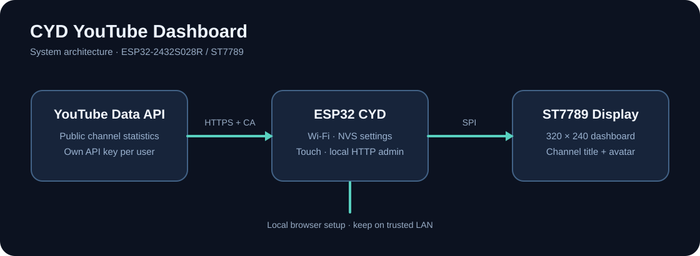

# CYD YouTube Dashboard

**Your YouTube channel, on a tiny dedicated touchscreen.**



This project turns a supported ESP32 Cheap Yellow Display into a standalone channel dashboard. It displays public YouTube statistics, offers on-device touch controls and provides a local web interface for configuration.

## Hardware

- **Tested board:** ESP32-2432S028R with original ESP32-D0WD-V3, 4 MB flash, **ST7789** 240×320 display and XPT2046 touch.
- USB **data** cable; Chrome or Edge for Web Serial installation.
- 2.4 GHz Wi-Fi and your own YouTube Data API v3 key for channel statistics.

Similar-looking CYD boards may have different display drivers or wiring. Do not flash an unverified variant.

## Install from your browser

Open **[CYD Web Flasher](https://massa-creto.github.io/cyd-youtube-dashboard/install/)** in Chrome or Edge on a desktop computer.

1. Connect your supported CYD via USB and close serial monitors.
2. Click **Verify package & device**, then select the USB serial device.
3. Review the selected installation mode and warnings.
4. A backup is **optional**. With a matching 4 MB backup, the installer selects application-only writing at `0x10000`. Without one, the current installer selects a **full three-image installation** (bootloader `0x1000`, partitions `0x8000`, firmware `0x10000`), which may make existing data inaccessible.
5. Confirm the risk and initiate the write. Keep USB connected until completion, then verify the display, touch, Wi-Fi and settings.

**Hardware evidence:** a browser application write completed and the device booted successfully with its previous settings on one ESP32-D0WD-V3 / 4 MB ST7789 CYD. This does **not** validate full three-image installation on factory-new boards or all CYD revisions.

**Important:** The installer checks packaged binary hashes and device identity. It does not guarantee that the firmware will boot on every board. Restore is **not implemented** in the browser installer. Read the [recovery guide](docs/WEB_FLASHER_SAFETY_AND_RECOVERY.md) before flashing.

## Optional full-device backup

A separate local Python companion can read the entire 4 MB flash, create a `.bin` file and provide a SHA-256 checksum. This was tested on the same device and took about 6 minutes. The progress indicator may remain at 0% until the operation completes; elapsed time continues to update.

```powershell
py -3.13 -m pip install esptool
py -3.13 tools/local_backup_server.py
```

Run those commands from the repository root, then open `http://localhost:8000/local-backup/`. Close any browser serial session first. The backup may contain Wi-Fi passwords, administrator settings and API credentials. **Do not upload it to GitHub or share it publicly.**

The local helper is **not available from GitHub Pages**. There is currently no verified full-device restore UI.

## Build the firmware yourself

1. Install [VS Code](https://code.visualstudio.com/) and [PlatformIO](https://platformio.org/install/ide?install=vscode).
2. Open the `firmware/` folder as a PlatformIO project.
3. Build environment `cyd_st7789`, then upload to a compatible board.
4. Configure Wi-Fi, your own YouTube API key and channel in the device interface.

The repository includes `firmware/src`, PlatformIO configuration, automated checks and the static installer in `installer-web/`. The website is deployed using GitHub Pages Actions.

## Features and documentation

- Public channel metrics and configurable screens
- Local device control panel, display and touch settings
- Wi-Fi setup and recovery access point behavior
- Device diagnostics and monitoring

See the [user guide](docs/USER_GUIDE.md), [API setup](docs/GOOGLE_YOUTUBE_API_SETUP.md), [security notes](docs/SECURITY.md), [feature matrix](docs/FEATURE_MATRIX.md), and [release status](docs/PUBLIC_RELEASE_STATUS.md).

## Safety, privacy and license

No Google credentials or private flash backups are included in this repository. The browser installer requests serial access only after you initiate it. The browser loads `esptool-js` from a version-pinned third-party CDN, so an internet connection is required for the USB installer. The local backup helper binds to localhost.

The original code is licensed under [PolyForm Noncommercial 1.0.0](LICENSE); documentation under [CC BY-NC-SA 4.0](docs/LICENSE). This is **source-available for noncommercial use**, not OSI-approved open source. See [third-party notices](THIRD_PARTY_NOTICES.md).

Made by [MassaCreto](https://www.youtube.com/@MassaCreto). Issues and contributions are welcome. Remove credentials and device identifiers from logs before sharing.
