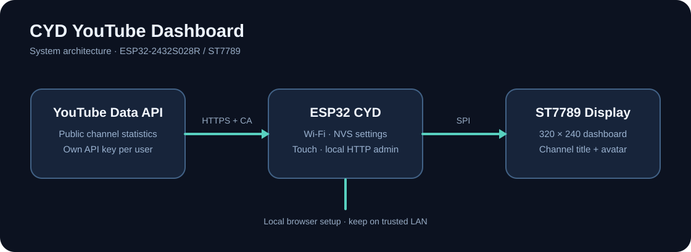

# Architecture

The CYD runs the Arduino framework on ESP32. It connects to Wi-Fi and polls YouTube Data API v3 using a user-provided API key. The ST7789 TFT displays public channel statistics. A local HTTP admin interface handles configuration, safe backup/restore and on-demand physical TFT readback. Remote touch is not a continuous video stream.

**Trust boundaries:** Google HTTPS uses a CA certificate bundle and requires valid time. Local HTTP Basic authentication is not encrypted; use a trusted network only. Wi-Fi and API credentials are stored in NVS without hardware flash encryption. The API key is transmitted as a URL query parameter to Google over TLS; avoid verbose URL logging.

**Supported target:** ESP32-2432S028R ST7789 configuration only. Other CYD variants may have different display and touch wiring and are not validated.
